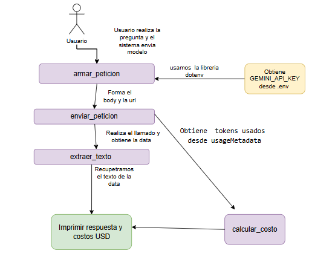

# Decisión de arquitectura: elección de modelo
  Ultimá fecha de la comparación: 24-10-2026

  Nombre de la aplicación: Huerto Urbano con IA
 ## Modelo elegido

modelo elegido: gemini-3.5-flash-lite

Breve descripción de la Aplicación a desarrollar: La Aplicación Huerto Urbano con IA tiene como objetivo apoyar a personas que no necesariamente poseen conocimientos de agronomía, para que puedan cultivar hortalizas de manera exitosa.

Algunos de los requisitos que necesito cumplir son:

-Disponibilidad: funcionamiento 24/7.

-Alta concurrencia: capacidad para atender múltiples usuarios simultáneamente.

-Calidad de las respuestas: proporcionar respuestas técnicas basadas en información preexistente y confiable.

 ## Diagrama de arquitectura
  
  
 ## Comparación de candidatos

Se realizaron cuatro iteraciones por cada modelo. Sin embargo, no fue posible ejecutar las pruebas con gemini-3.8-flash, debido a que nunca estuvo disponible.
En cada iteración se registraron la latencia y el costo. Posteriormente, se calcularon el costo acumulado y la latencia promedio, cuyos resultados se presentan en la siguiente tabla.
La consulta utilizada para evaluar todos los modelos en cada iteración fue:
Eres un experto en horticultura en Chile. Indica los requisitos para sembrar tomates en Villa Alemana, Región de Valparaíso, considerando su clima mediterráneo. Incluye: época de siembra, temperatura, horas de sol, suelo, riego, nutrientes y distancia de plantación. Como agricultor, dime cuál es el cultivo de hortalizas más productivo para la Región de Valparaíso.

| Criterio |  modelo gemini-3.5-flash-lite  | gemini-3.6-flash | gemini-3.8-flash |
|---|---|---|---|
| Tarifa de entrada en UD por millón de tokens | $0.30 usd| $0.75 usd| $0.75 usd |
| Tarifa de salida en USD por millón de tokens | $2.50 usd| $3.75 usd | $3.75 usd |
| Costo Acumulado | $0. 012265 USD| $0. 023465 USD | No fue posible evaluar pues el modelo no estuvo disponible
| Latencia promedio en segundos | 6.73 | 7.01| No fue posible evaluar pues el modelo no estuvo disponible
| Calidad de respuesta  | Entrega información técnica útil y en el contexto  | Entrega información técnica útil ligeramente más extensa | No fue posible evaluar pues el modelo no estuvo disponible

Fuente de las tarifas:https://ai.google.dev/gemini-api/docs/pricing?hl=es-419

Observación en las pruebas: Se ejecutaron cinco ciclos de pruebas, observándose variaciones poco significativas en la latencia y los costos entre las iteraciones de un mismo modelo.

En cuanto a la disponibilidad, el modelo gemini-3.5-flash-lite presentó dos fallos durante las pruebas, mientras que gemini-3.8-flash no estuvo disponible en ninguno de los intentos realizados.

 ## Justificación

 Elegi el modelo gemini-3.5-flash-lite por su relación entre costo, latencia y disponibilidad observada.
 El criterio mas relevante para mi arquitectura fue la relación  disponibilidad, costo, calidad de respuesta 
 una limitación que encontre fue la poca disponibilidad de modelos en la capa gratuita y modelos antiguos que ya no presentan valores en la tabla oficial
 Se seleccionó gemini-3.5-flash-lite por su relación entre costo, latencia y disponibilidad observada, considerando los modelos evaluados. Sin embargo, las interrupciones detectadas evidencian la necesidad de implementar mecanismos de reintento y manejo de errores para mejorar la continuidad del servicio.
 

  
 ## Alternativa descartada y por qué
 Se descarto el modelo gemini-3.8-flash, pues en todos los intentos nunca estuvo disponible , y el gemini-3.6-flash presento intermitencia en su disponibilidad.